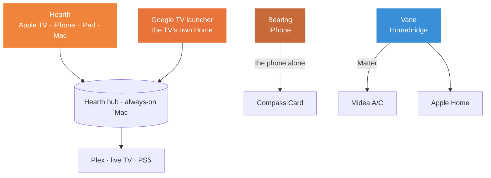

**Native apps for my own living room, my own transit card and my own air conditioner: private by design, running on hardware I own.**

      

## The apps

<table>
<tr>
<td width="50%" valign="top">

<b>Home, on the big screen</b> 
The home on the TV: an Apple TV app for the TV, live TV, Plex, games and the consoles, with the hub that serves it from an always-on Mac.

<b>Apple TV, iPhone and iPad app</b> · tvOS 26+, iOS 26+

<b>What’s new in 0.1.2</b> 2026-11-26

- Open Hearth on any tab
- More in Search before you type
- A livelier opening
- Ask fits the keyboard
- and 3 more

</td>
<td width="50%" valign="top">

<b>The TV’s own Home, in Hearth’s look</b> 
The Home on the living room's Google TV, in Hearth's look.

<b>Android TV app</b> · Google TV, Android 10+

Not released yet: in use at home while it settles.

</td>
</tr>
<tr>
<td width="50%" valign="top">

<b>Your Compass Card</b> 
A private iPhone app for one Compass Card, Vancouver's transit card: its balance, its trips and what they cost, and a reload in a few taps.

<b>iPhone app</b> · iOS, TestFlight internal testers only

<b>What’s new in 0.2.0</b> 2026-11-26

- Tap an alert to open it
- Search and export Spending
- Search Settings
- Widgets keep up by themselves
- and 6 more

</td>
<td width="50%" valign="top">

<b>Every mode of the A/C, in Apple Home</b> 
A Midea A/C in Apple Home, with no Midea account and no cloud.

<b>Homebridge platform</b> · Homebridge 2, Node 22+

Not released yet: in use at home while it settles.

</td>
</tr>
</table>

## How they fit together

Written by a script from each app’s own README, version and changelog, every time one of them changes.

